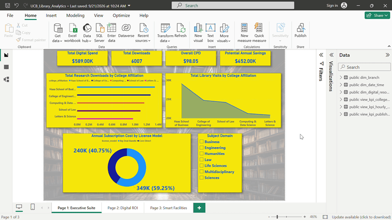
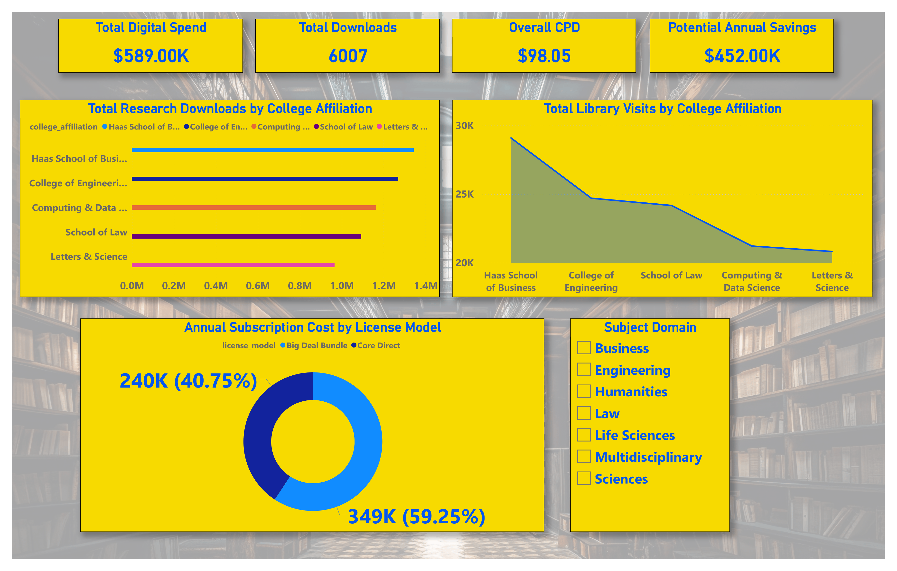
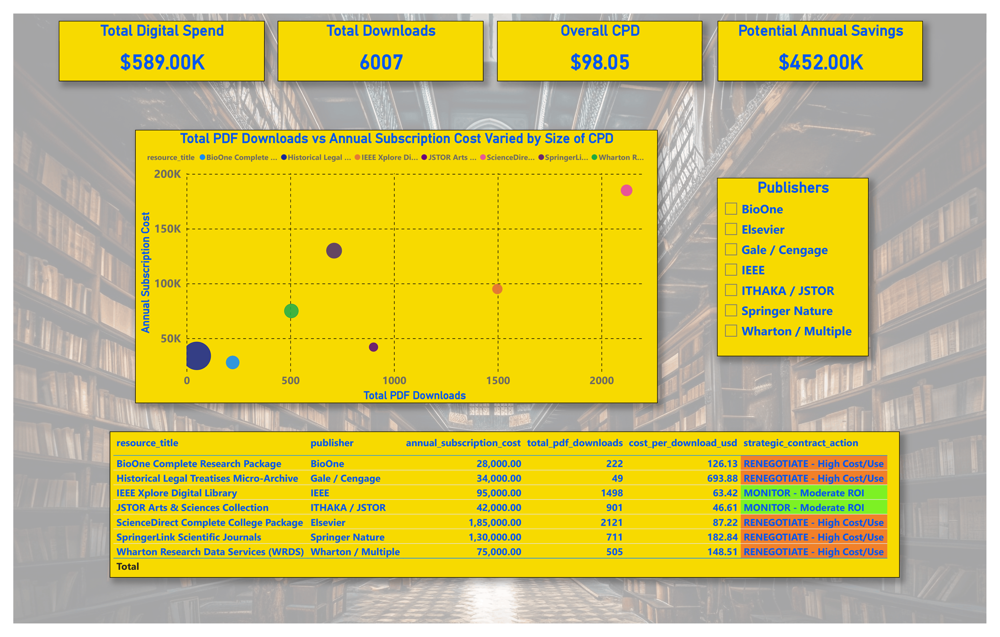
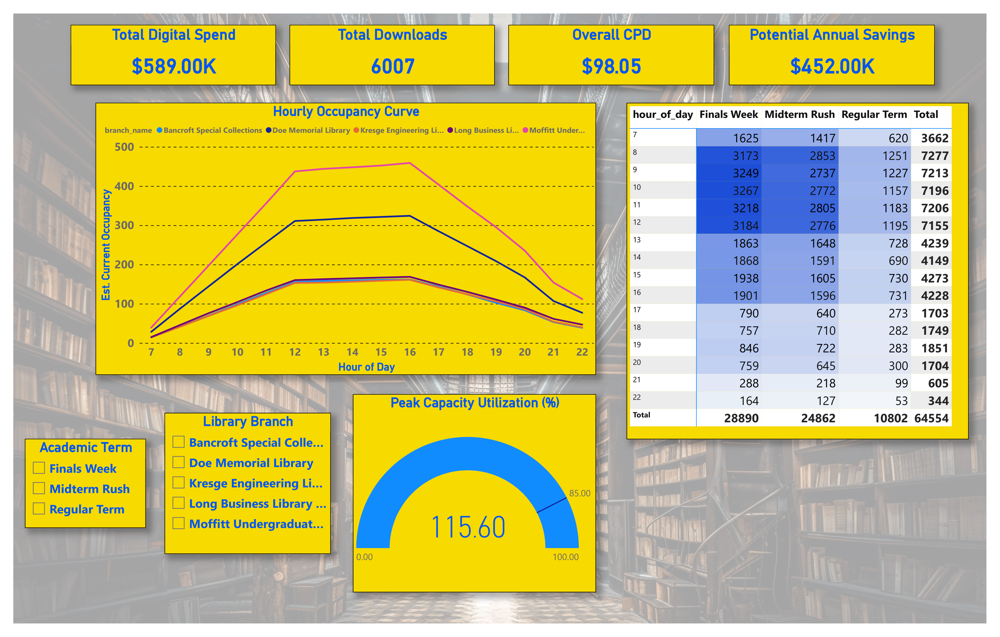

# 🏛️ UC Berkeley Library Operations & Digital Asset ROI Analytics
**Enterprise SQL Data Warehousing, Power BI Decision Intelligence & Python Executive Report Automation**

<!-- ========================================================================= -->
<!-- QUICK LINKS & RESOURCE PLACEHOLDERS -->
<!-- Replace '#' with your actual URLs (e.g., LinkedIn, Portfolio, Drive, Live Demo) -->
<!-- ========================================================================= -->

---

## 📌 Executive Summary & Business Impact

Academic research library networks operate under dual operational pressures: **rapidly inflating commercial digital journal licensing costs** and **severe foot-traffic volatility** across campus study spaces.

Focusing on the **University of California, Berkeley** library network, this project unifies **127,000+ transactional records** (RFID security turnstiles, digital proxy clickstreams, and circulation loans) into a structured **PostgreSQL Star Schema Data Warehouse**. This backend connects directly to an executive **3-Page Power BI Dashboard** to deliver actionable operational decision support.

### 🎯 Key Business Outcomes:

* **💰 $452,000 in Contract Renegotiations Identified:** Audited **$589,000** in digital subscription spend across 6,007 verified research downloads (average Cost-Per-Download: **$98.05**), exposing extreme inefficiencies such as **$693.88 per download** for the *Historical Legal Treatises* archive ($34K fee for only 49 downloads).
* **🚨 Diagnosed a 115.60% Finals Week Capacity Breach:** Built SQL sliding window functions to convert discrete entry/exit logs into 24-hour building headcounts, revealing that Moffitt Library exceeds safe seating limits by **+30.6%** during exams, while specialized hubs like *Bancroft* operate below **20% capacity**.
* **⚖️ Cross-College Resource Equity:** Benchmarked consumption patterns across 5 academic divisions, demonstrating that the **College of Engineering and Haas School of Business account for >68% of visits and 70% of downloads**, while 59.25% ($349K) of library costs remain subsidised through general overhead.

---

## 🖥️ Executive Power BI Dashboard Preview

<!-- ========================================================================= -->
<!-- PLACEHOLDER 1: INTERACTIVE DEMO GIF (OR PREVIEW HERO BANNER) -->
<!-- Save your 10-20 sec demo clip inside assets/dashboard_demo.gif -->
<!-- ========================================================================= -->

### 1️⃣ Page 1: Provost Executive Suite (Macro Governance & Departmental Equity)
*Centralizes executive KPIs ($589K Spend, 6,007 Downloads, $98.05 CPD, $452K Savings Pool), cross-college visit-to-download ratios, and licensing model distribution.*

<!-- ========================================================================= -->
<!-- PLACEHOLDER 2: PAGE 1 SCREENSHOT (PNG) -->
<!-- Save your screenshot inside assets/page1_executive_suite.png -->
<!-- ========================================================================= -->

### 2️⃣ Page 2: Collection Intelligence & Vendor Audit (Publisher ROI)
*Features a Cost-Per-Download (CPD) scatter plot and automated rule-based contract categorization (`CANCEL`, `RENEGOTIATE`, `MONITOR`, `RENEW`).*

<!-- ========================================================================= -->
<!-- PLACEHOLDER 3: PAGE 2 SCREENSHOT (PNG) -->
<!-- Save your screenshot inside assets/page2_digital_roi.png -->
<!-- ========================================================================= -->

### 3️⃣ Page 3: Smart Facilities & Space Telemetry (Space & HVAC Optimization)
*Tracks 24-hour occupancy curves across 5 campus branches, a capacity utilization gauge (85% warning marker vs. 115.60% peak breach), and an hourly entry heatmap matrix.*

<!-- ========================================================================= -->
<!-- PLACEHOLDER 4: PAGE 3 SCREENSHOT (PNG) -->
<!-- Save your screenshot inside assets/page3_smart_facilities.png -->
<!-- ========================================================================= -->

